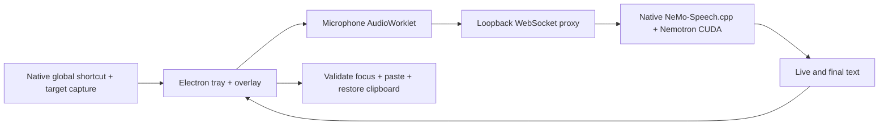

# QuillKey

Local English voice dictation for Windows. Click into a chat input, then click the tiny floating microphone to start. Click it again to finish and paste into that field. Hover unfolds the control; **Escape** cancels. **Ctrl + Alt + Space** remains available for hold-to-talk.

QuillKey uses NVIDIA Nemotron streaming ASR on your own GPU. No transcription API, account, subscription, or remote cleanup model is required. This is an early Windows preview, with an independent identity and implementation.

## Install and use

Run `QuillKey-0.3.1-Setup.exe` from the build output. Installation is per-user, with Start menu and desktop shortcuts. The installer bundles the English model and CUDA runtime; Node.js and Python are not required by the installed app. This preview is unsigned.

1. Open QuillKey and wait for **Local engine ready**.
2. Place the caret in an editable field in another app.
3. Click the floating microphone, speak, then click again to finish. Alternatively, hold **Ctrl + Alt + Space** and release all keys to finish.
4. Keep focus in the same field until finalization finishes. Press **Escape** to cancel.

Closing the dashboard hides it in the system tray. Use the tray menu to show it or quit. Dashboard recordings stay in the editable transcript for explicit copying; floating-mic and shortcut recordings request automatic insertion. If insertion is unavailable, QuillKey copies the final text and shows **Copied — press Ctrl+V**. It never presses Send.

Requirements: Windows x64, .NET Framework 4.x (included with modern Windows), compatible NVIDIA CUDA GPU/driver, and roughly 2 GB free disk space during installation. Validated model inference on an RTX 2070 SUPER with 8 GB VRAM. Other GPUs and CPU-only machines have not been validated; this build explicitly selects CUDA.

## Behavior and limitations

- Native global shortcut, nonactivating overlay, streaming partials, final transcript, cancel, and tray lifecycle.
- The helper records the original window/control and UI Automation identity when available. It refuses insertion if focus changes or a password control is detected. Unsupported or elevated apps use the clipboard fallback.
- Insertion sends one paste shortcut. Clipboard formats are snapshotted conservatively and restored after 600 ms only if the clipboard sequence is unchanged. If safe preservation or insertion fails, QuillKey deliberately replaces the clipboard with your final transcript for Ctrl+V. If the clipboard is unavailable, the transcript remains in QuillKey and an error is shown. Slow target apps may not consume a paste before restoration; sending input is not proof the target accepted it.
- Very short shortcut taps cancel pending microphone setup. Start speaking once the overlay is listening. Recordings support up to 30 minutes, then automatically stop and finalize for insertion or clipboard copy. Completed segments remain in the dashboard. A separate 32-minute watchdog closes stuck sessions; long-session accuracy and resource use still need real-world testing.
- No AI rewriting, filler cleanup guarantee, vocabulary editor, model switch, auto-start, or automatic updates yet. Parakeet and optional local refinement are future work.
- Audio and transcripts are processed locally. There is no app transcript history or audio recording store. Diagnostic logs live under the Electron user-data directory and may contain runtime diagnostics. Setup/build downloads dependencies; normal transcription uses loopback services. We have not audited vendor binaries with a network capture.

## Build from source

Install Node.js 24 LTS on Windows. From this directory:

```powershell
powershell -NoProfile -ExecutionPolicy Bypass -File .\Setup.ps1
node node_modules/electron/install.js
npm run build:native
npm run desktop
npm run dist:win
```

Setup downloads pinned runtime/model artifacts and verifies SHA-256 hashes. `electron/install.js` ensures the official Electron runtime is present when npm lifecycle scripts are disabled. The execution-policy option applies only to that PowerShell process. `dist/` holds the installer and unpacked app. Model weights, native binaries, build output, and logs are excluded from Git.

The original browser prototype remains available via `npm start` at `http://127.0.0.1:8765`. The desktop app owns ports 18765 and 18766. Avoid running both GPU engines at once on low-memory cards.

## Architecture



The renderer is sandboxed with context isolation and a narrow IPC bridge. The engine listens on loopback with a fresh bearer secret. The proxy checks Host/Origin and allows one recording. Native target tokens are opaque and one-use. UI session IDs reject stale completion events.

## Tests

```powershell
npm test
npm run build:native
powershell -NoProfile -File tests/New-SyntheticFixture.ps1
# Requires an idle browser-mode server:
node tests/session-integration.mjs
# Own Electron renderer + fake synthetic microphone + real CUDA model:
npm run desktop -- --smoke-test
# Interactive disposable window; preserves the clipboard:
.\native\QuillKey.Native.exe --self-test
```

See [desktop validation](tests/desktop-validation.md) for observed results and remaining manual checks. Synthetic speech is not a general microphone-accuracy benchmark. Test ordinary dictation, corrections, technical names, focus changes, Escape, locked clipboard, and engine failure before relying on this preview for important text.

## Components and attribution

- [NVIDIA NeMo-Speech.cpp v0.2.0](https://github.com/NVIDIA/NeMo-Speech.cpp/releases/tag/v0.2.0), Windows CUDA runtime.
- [Nemotron streaming English 0.6B](https://huggingface.co/nvidia/nemotron-speech-streaming-en-0.6b), Q8 GGUF pinned to revision `ebe59e5a817142986528bbbee5dba8db7b38ed50`.
- Electron, ws, and a small Windows C# helper.

See [NOTICE.txt](NOTICE.txt) and `licenses/`. The NVIDIA model is governed by its own license, not the app's source terms. QuillKey source is publicly reviewable; a redistribution license for original app code has not been selected. No proprietary Wispr artifacts or code are included.
